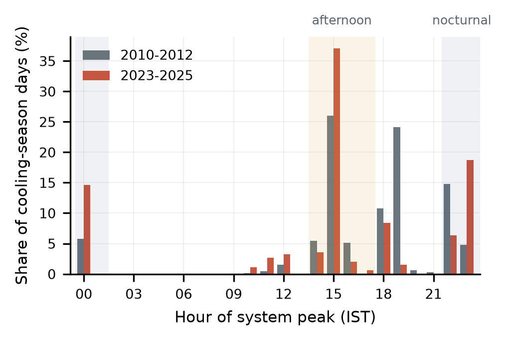
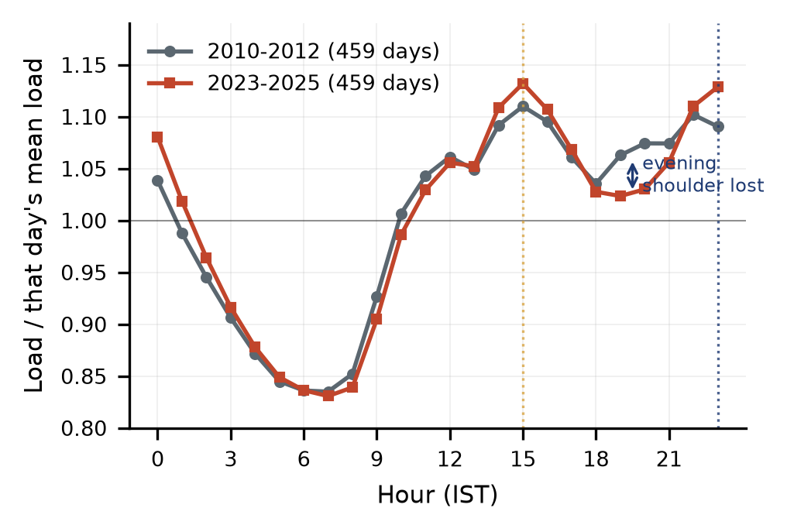
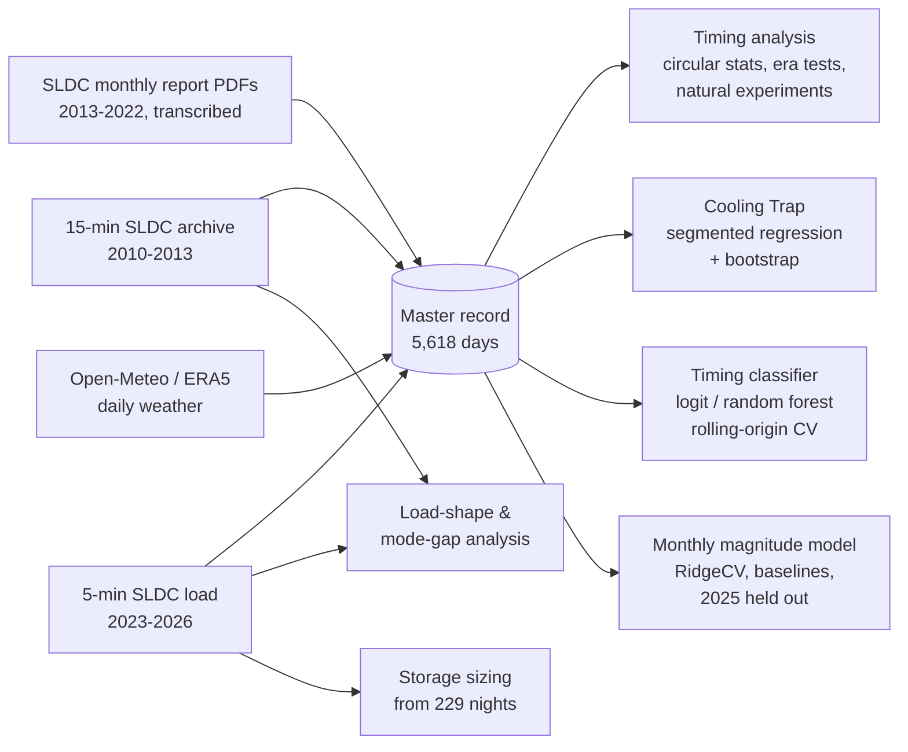
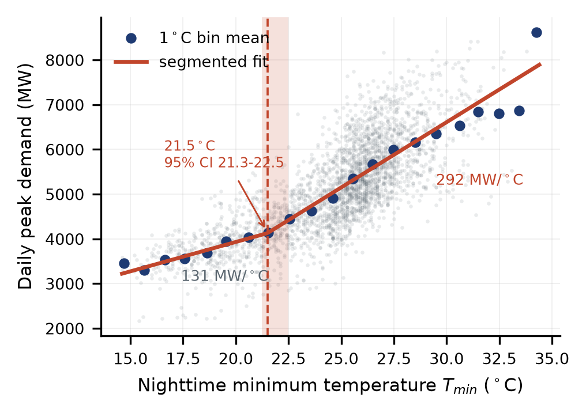
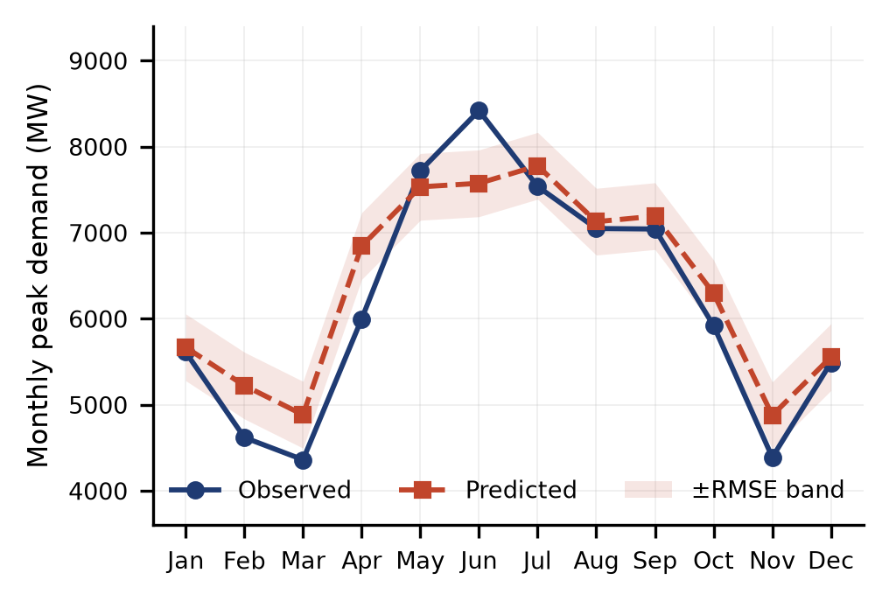
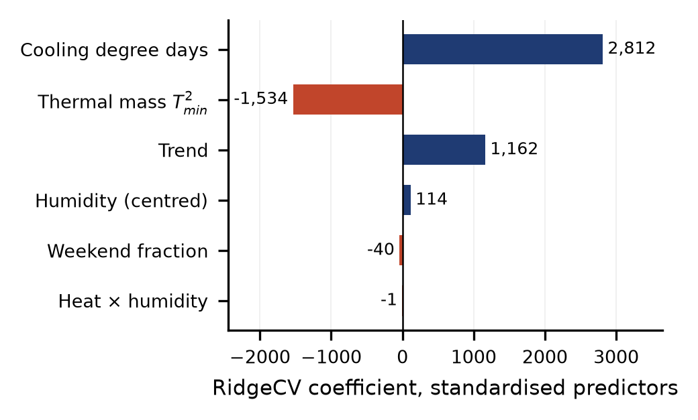

# From Diurnal to Bimodal: Measuring the Nocturnal Shift in Delhi's Peak Electricity Demand from Daily Peak-Timing Records

[](https://doi.org/10.5281/zenodo.22296253)
[](LICENSE)
[](LICENSE-DATA.md)


**Swastik Verma** and **Pummy Dhiman**
Chitkara University Institute of Engineering and Technology, Chitkara University, Punjab, India

*4th IEEE International Conference on Industrial Electronics: Developments & Applications (ICIDeA 2026)*

This repository holds the data, analysis code and outputs behind the paper. The scripts reproduce the paper's headline results from the data in this repository, using fixed random seeds (see [Reproducibility map](#7-reproducibility-map)).

---

## Summary

Delhi's peak electricity demand used to come in the afternoon. We assembled **5,618 daily records** of the Delhi system peak (29 March 2010 to 12 January 2026). Each record has the peak's size in MW and the clock time it occurred. With these records we measured how the timing of the peak has changed.

- **The peak has moved toward the night.** On cooling-season days (April to October), the share of days whose peak fell between 22:00 and 01:59 rose from **25.4 % (2010–2012) to 39.7 % (2023–2025)**. Both eras were measured by sub-hourly instruments, 642 days each, giving z = 5.48 and p = 4.3 × 10⁻⁸.
- **The night did not replace the afternoon.** The afternoon share *grew*, from 36.6 % to 43.3 %. What collapsed was the **evening** peak, from 35.8 % to 10.0 %. Delhi now has **two peaks of nearly equal height**, at about 15:00 and about 23:00. They differ by 0.3 % of the daily mean load.
- **The late-night window is narrow and stable.** Nocturnal peaks centre on **23:23 IST**. All 418 nocturnal peaks recorded by sub-hourly instruments fall between 22:00 and 00:59.
- **Removing daytime commercial load pushes the peak into the night.** Weekends raise the odds of a nocturnal peak 3.99-fold. During the 2020 lockdown, 83.5 % of April–June days peaked at night, against 52.4 % in comparable years.
- **Demand speeds up above a night minimum of 21.5 °C (the "Cooling Trap").** Below that temperature, peak demand rises by 131 MW for each extra degree; above it, by **292 MW** per degree. Delhi's nights are above 21.5 °C on 80.9 % of cooling-season days.
- **Storage need.** About **1,547 MWh** of installed storage, discharging at **606 MW**, would flatten the nocturnal peak on the 95th-percentile night. Solar generation cannot serve a peak at 23:00.

<p align="center">
  
  
</p>
<p align="center"><sub><b>Left:</b> hour of the daily system peak on cooling-season days, first and last eras. Two attractors, at 15:00 and 23:00, with the 19:00 evening peak gone. <b>Right:</b> mean summer load shape (May–September), each day divided by its own mean load. The afternoon and nocturnal modes were 0.019 apart in 2010–2012 and are 0.003 apart in 2023–2025.</sub></p>

---

## Contents

1. [Research question](#1-research-question)
2. [Data](#2-data)
3. [How the research was done](#3-how-the-research-was-done)
4. [Results](#4-results)
5. [Practical implications](#5-practical-implications)
6. [Limitations](#6-limitations)
7. [Reproducibility map](#7-reproducibility-map)
8. [Running the code](#8-running-the-code)
9. [Repository layout](#9-repository-layout)
10. [Citation, licence, data availability](#10-citation-licence-and-data-availability)

---

## 1. Research question

Operational reports and policy studies say Delhi's system peak now often falls late at night, typically between 22:00 and 01:00, instead of in the afternoon. That matters for planning. Solar generation can serve an afternoon peak, but not one near midnight, which has to be met by storage or dispatchable generation.

Previous research could not test this claim, because it uses **monthly or annual peak magnitudes**. A monthly maximum of 8,000 MW is the same number whether it happened at 15:00 or at 23:30. So the late-night peak was reported, not measured. Its centre, its width and its stability had never been estimated.

This study asks:

1. **Has the peak shifted, and by how much?** We measure it on instrument-resolved data at both ends of the period.
2. **What moved?** Did night replace afternoon, or did something else change?
3. **Where exactly is the late-night window, and is it stable?**
4. **What decides whether a given day peaks at night?** We look at commercial load, heat and humidity.
5. **At what night temperature does demand speed up, and how much storage would flatten the night peak?**

---

## 2. Data

### 2.1 The peak-timing record

The whole study rests on one assembled file, [`Dataset/power data/delhi_master_dataset_v3.csv`](Dataset/power%20data/delhi_master_dataset_v3.csv). It has 5,618 rows, one per day, from 2010-03-29 to 2026-01-12. Each row has the daily system peak (MW), the clock time of that peak (IST), and the day's weather. It was harmonised from three public Delhi State Load Despatch Centre (SLDC) series. Where two series overlap, the finer one wins.

| Source | Period | Resolution | Days in record | `source` label | Timestamp type |
|---|---|---|---:|---|---|
| Delhi SLDC 15-minute licensee-wise archive (Columbia Sustainable Engineering Lab) | Mar 2010 – early 2013 | 15 min | 1,078 | `SLDC_15min_archive` | instrument |
| Delhi SLDC monthly operational reports (PDFs, transcribed by hand) | 2013 – 2022 (+ gaps in 2023/24) | daily peak + reported time | 3,526 | `SLDC_monthly_PDF_fixed` | as stated in the report |
| Delhi SLDC 5-minute system load (Kaggle) | Apr 2023 – Jan 2026 | 5 min | 1,014 | `SLDC_5min` | instrument |

Days by year and source:

| Year | 2010 | 2011 | 2012 | 2013 | 2014–2022 | 2023 | 2024 | 2025 | 2026 |
|---|---|---|---|---|---|---|---|---|---|
| 15-min archive | 278 | 365 | 366 | 69 | – | – | – | – | – |
| Monthly reports | – | – | – | 296 | 334–365 per year | 31 | 2 | – | – |
| 5-min series | – | – | – | – | – | 275 | 364 | 365 | 10 |

Of the 5,618 timestamps, **2,092 are measured by instruments** (5 or 15 min) and **3,526 are the time stated in an operational report**.

### 2.2 Which claim rests on which data

Monthly data cannot tell you what time of day a peak happened, so **no timing claim in this study uses monthly data**. The headline comparison uses only the two instrument-measured eras, so it does not depend on any report-stated timestamp.

| Claim | Evidence | Resolution | n |
|---|---|---|---:|
| Shift, 25.4 → 39.7 % | 2010–12 against 2023–25 | 15 min; 5 min | 642; 642 |
| Window centred at 23:23 | Sub-hourly nocturnal peaks | 5, 15 min | 418 |
| Trend and mechanism | Full cooling-season record | mixed | 3,385 |
| 2020 lockdown | Apr–Jun 2020 | report-stated | 91 |
| Threshold 21.5 °C | Daily peaks and weather, 2013+ | daily | 2,743 |
| Magnitude model | Monthly maxima | monthly | 128 |
| Storage sizing | Nocturnal load curves, 2023–25 | 5 min | 229 |

### 2.3 How the record was validated

- **Against official figures.** Seventeen officially published annual and monthly maxima are reproduced exactly. Across 33 overlapping months, the record differs from the Central Electricity Authority (CEA) Power Supply Position by 0.52 % on average. CEA and Delhi Economic Survey figures were used **for validation only**, never as model inputs.
- **Report-stated timestamps against instruments.** Where an independent sub-hourly series overlaps the report-stated record, the peak hour agrees within one hour on **92.8 %** of days in a 69-day overlap in 2013, and on **95.7 %** in a 255-day overlap in 2023.
- **Against individual published events.** Peak magnitudes match published figures exactly on four dates in 2016–2021. Independent counts of nocturnal-peak days from the Centre for Science and Environment are reproduced: 14 days in May 2016 (14 here) and 21 in May 2018 (22 here).
- **Integrity checks in code.** Every run of the pipeline checks that there are no duplicate dates, that peaks are between 1,000 and 10,000 MW, that the peak hour is between 0 and 23, that Tmin ≤ Tmax, and that humidity is between 0 and 100 %.

### 2.4 Meteorology

Daily weather (`tempmin`, `tempmax`, `temp`, `humidity`, `windspeed`) is already joined into the master file for 5,608 of the 5,618 days. Per the paper, the meteorology comes from the Open-Meteo Historical Weather API (ERA5 reanalysis, CC BY 4.0), as city-wide daily values. Two weather files are included:

- `Dataset/Weather data/open-meteo-28.58N77.19E220m.csv`: Open-Meteo daily relative humidity (mean/max/min) for 28.58 °N, 77.19 °E, 2000–2025. This series fills humidity gaps. It provides all humidity values for 2010–2012 and about 40 % for 2013–2017; most later days use station-measured humidity. The paper checks that the humidity result holds on station-measured days only.
- `Dataset/Weather data/delhi-weather-aqi-2025.csv`: hourly weather and air quality for six Delhi locations in 2025. Included for reference; **not used by the analysis scripts**.

### 2.5 Master dataset columns

| Column | Meaning |
|---|---|
| `date`, `year`, `month`, `dayofweek`, `day_name` | Calendar fields (`dayofweek`: Monday = 0) |
| `is_weekend` | 1 for Saturday/Sunday |
| `is_cooling_season` | 1 for April–October |
| `peak_mw` | Daily system peak demand met (MW) |
| `peak_time`, `minofday`, `peak_hour` | Clock time of the peak (IST): `HH:MM`, minutes after midnight, hour 0–23 |
| `is_nocturnal` | Peak hour in {22, 23, 0, 1}, i.e. 22:00–01:59 |
| `is_afternoon` | Peak hour in {14, 15, 16, 17}, i.e. 14:00–17:59 |
| `tempmin`, `tempmax`, `temp` | Daily min / max / mean temperature (°C) |
| `humidity` | Daily mean relative humidity (%) |
| `precip`, `sealevelpressure` | Not populated (all empty) |
| `windspeed` | Daily wind speed |
| `CDD` | Night-based cooling degree days, max(0, Tmin − 18 °C) |
| `Tmin_sq` | Tmin² (nocturnal thermal-mass term) |
| `humidity_centered` | RH − mean(RH) |
| `heat_x_humid_centered` | CDD × centred RH (latent-heat interaction) |
| `days_since_start` | Days since 2010-03-29 (trend) |
| `source` | Which of the three series supplied the row |
| `resolution_min` | 15 or 5 for instrument rows; empty for report-stated rows |

### 2.6 Raw files and known issues

| File | What it is | Notes |
|---|---|---|
| `Dataset/power data/delhi_sldc_15min_2010_2013.csv` | 15-minute load per distribution company plus a `Total` row (36 MB) | `days` is an Excel serial date; the scripts use the `discom == "Total"` rows |
| `Dataset/power data/5_min_2023to2026.csv` | 5-minute system load, 2023-04-01 to 2026-01-12 | Timestamps are **day-first** (`dd-mm-yyyy HH:MM`); 7,932 missing load values |
| `Dataset/power data/delhi power data from 2013 to 2025 monthly files/` | One CSV per year, transcribed from the SLDC monthly report PDFs | Intermediate files. Columns are **shifted** in the 2021 and 2023–2025 files (e.g. `peak_demand_mw` holds a difference column, and dates are malformed). The master file holds the corrected values (`SLDC_monthly_PDF_fixed`); use the master, not these, for analysis. |

The master file was built from these sources before the analysis scripts were written. The step that assembled and reconciled it (PDF transcription, merging, joining weather) is **not** part of this repository. The master file is the canonical input to every script here.

---

## 3. How the research was done



### 3.1 Definitions

| Term | Definition |
|---|---|
| Cooling season | April–October: the months when cooling, not heating, drives Delhi's load |
| Nocturnal peak | Daily system peak between **22:00 and 01:59** |
| Afternoon peak | 14:00–17:59 |
| Evening peak | 18:00–21:59 |
| Eras | 2010–12, 2013–16, 2017–19, 2020–22 (pandemic-disrupted), 2023–25 |
| Instrument eras | 2010–12 (15 min) and 2023–25 (5 min), the only eras with measured timestamps |

### 3.2 Features that describe the night

Four features describe the physical mechanism:

- **Night-based cooling degree days**, $CDD = \max(0,\ T_{min} - 18\,^{\circ}\mathrm{C})$. Most studies use the daily *maximum*. We use the **minimum**: if the night does not fall below about 18 °C, passive cooling stops working and air conditioners run all night.
- **Latent-heat interaction**, $I_{latent} = CDD \times (RH - \overline{RH})$. Humidity is **mean-centred before the product is formed**. Uncentred, the term correlates with CDD at r = 0.926, with a variance inflation factor (VIF) of 48.8, and it flips sign under regularisation. Centring brings these down to r = −0.059 and VIF 6.94 (stage 08 of the pipeline).
- **Nocturnal thermal mass**, $T_{min}^2$: the nonlinear release of heat stored during the day.
- **Trend**, days since the first record. This stands in for growth in installed cooling. It cannot separate air-conditioner stock from population or floor space, and is not read as either.

### 3.3 Circular statistics for clock time

Clock time wraps at midnight. The arithmetic mean of 23:50 and 00:10 is midday, which is wrong. All timing summaries therefore convert each time to an angle, $\theta = 2\pi \cdot \text{minutes}/1440$, then compute:

- the circular mean $\bar\theta = \operatorname{atan2}(\overline{\sin\theta},\ \overline{\cos\theta})$ and the resultant length $R$;
- a **Rayleigh test** for non-random clustering, $Z = nR^2$;
- a 95 % confidence interval on the mean, from the circular standard deviation $\sqrt{-2\ln R}/\sqrt{n}$.

### 3.4 Measuring the shift

- **Headline test**: a two-proportion z-test of the nocturnal share, 2010–2012 against 2023–2025. Both eras come from instruments, 642 cooling-season days each.
- **Trend**: logistic regression of the nocturnal indicator on year, within each era and across the full span. Linear trend in the annual evening share.
- **Is the post-2022 fall real?** A logit of `is_nocturnal` on CDD, Tmax, humidity, weekend and a post-2022 indicator, under **four different baselines**. All four are reported, not just the most convenient.
- **Weather or behaviour?** A logit fitted on a baseline era predicts the 2023–2025 nocturnal share from 2023–2025 weather. The gap between predicted and actual splits the change into a part due to weather and a part due to changed response.

### 3.5 Load shape and the mode gap

Using only the sub-hourly series, each summer day (May–September) is divided by its own mean load and averaged by hour, so the curves from the two eras can be compared on the same scale. For every night we compute the afternoon maximum minus the nocturnal maximum, as a percentage of that day's mean. A 22:00–01:59 night is assigned to the day it started on. This measures how close the two modes are, and how often a day is effectively a tie (within 2 %).

### 3.6 Two natural experiments

- **Weekends.** Weather does not differ systematically by day of the week, so the weekday/weekend difference isolates commercial and institutional daytime load. Test: chi-squared on weekday × nocturnal, and the odds ratio.
- **The 2020 lockdown.** We compare April–June 2020 with the same months in 2018, 2019 and 2022 (two-proportion z-test), and check whether lockdown weekdays look like ordinary weekends.

Neither is a controlled experiment. Both are reported as associations.

### 3.7 What predicts a nocturnal day: the timing classifier

- **Target**: `is_nocturnal` on cooling-season days with weather (n = 3,385).
- **Features**: CDD, centred RH, CDD × centred RH, weekend, Tmin².
- **Models**: logistic regression (statsmodels for the coefficient table; scikit-learn for cross-validation) and a random forest (400 trees, minimum leaf 5).
- **Evaluation**: **rolling-origin cross-validation** (`TimeSeriesSplit`, 5 folds). Each fold trains on everything before a cut-off and tests on what comes after, so no model sees its own future. The scaler is fitted on the training fold only. The comparison point is a majority-class baseline.
- **Ablation**: nocturnal predictors (CDD and the humidity interaction) against daytime predictors (Tmax) against weekend alone.
- **Interpretation**: marginal effects of Tmin and humidity on P(nocturnal), the Tmin at which humidity's net effect changes sign, and the turning point of the Tmin² term.

### 3.8 The Cooling Trap: segmented regression

On cooling-season days from 2013 onward (n = 2,743), daily peak demand is regressed on night minimum temperature with a single hinge:

$$
P = a + b_1\,T_{min} + b_2\,\max(0,\ T_{min} - \tau)
$$

- $\tau$ is found by **grid search** over 16–32 °C in 0.25 °C steps, minimising the residual sum of squares. The estimate lies inside the grid, not on its edge.
- A 95 % confidence interval comes from **2,000 bootstrap resamples** of days, refitting $\tau$ each time.
- **Why the cooling season only**: across the whole year, demand against Tmin is U-shaped (heating below a balance point of about 14 °C), and a single hinge cannot fit a U.
- **Why 2013 onward**: in 2010–2012 the response to night heat was roughly half as steep. Pooling the two regimes makes the bootstrap bimodal. Timing analyses use no weather, so they keep every year.
- **Era sensitivity**: with $\tau$ held fixed, both slopes are refitted within each era (HC3 standard errors). They are reported in MW/°C and as % of the era's mean peak per °C, because a bigger grid adds more MW per degree even with no change in behaviour.

### 3.9 Monthly magnitude model

- **Target**: monthly system peak, the maximum of daily peaks (the CEA reporting convention). Months need at least 15 days of data. Years 2013 onward, **excluding 2020–2021**, because the lockdown suppressed the demand *level*. That leaves 128 months.
- **Features**: CDD, Tmin², centred RH, CDD × centred RH, trend, weekend fraction, and 11 month indicators. Weather is the monthly mean of daily values.
- **Models**: RidgeCV (α over 30 log-spaced values in [10⁻³, 10²]), LassoCV, ElasticNetCV, OLS and a random forest (500 trees, minimum leaf 2), with `RobustScaler` fitted per fold.
- **Baselines**: seasonal-naive (same month last year) and month-indicators-plus-trend.
- **Checks**: fold-by-fold R², empirical 95 % prediction intervals from pooled out-of-fold residuals, three ways of handling COVID, and a **true out-of-sample test**: trained through 2024, scored on the 12 observed months of 2025 without refitting.

### 3.10 Storage sizing from observed load curves

For every cooling-season night in the 5-minute series (April 2023 – October 2025) whose daily peak fell in the nocturnal window (**229 nights**):

1. take the **22:00–02:00** window, assigned to the evening it starts on, and require at least 36 of its 48 samples;
2. set the shaving target to the **load at 22:00**;
3. energy = $\sum \max(0,\ L_t - L_{22:00}) \cdot \tfrac{5}{60}$ MWh; power = the maximum excess; duration = hours above target;
4. take the **95th percentile** across nights as the design point, then gross it up for round-trip efficiency η = 0.88 and depth of discharge 0.90.

The three assumptions (window, target, η/DoD) are stated so that they can be challenged.

### 3.11 Hyperparameters and reproducibility

All parameters are in the `Config` dataclass at the top of [`delhi_peak_study_v3.py`](python%20script/delhi_peak_study_v3.py): windows, cooling months, CDD base, threshold grid, bootstrap count, CV folds, storage assumptions, COVID handling, and the start year for weather models. Seeds are fixed at 42.

---

## 4. Results

Numbers marked **†** come from supplementary analysis reported in the paper and are not yet computed by the scripts in this repository (see [Section 7](#7-reproducibility-map)). Everything else is produced by the scripts here.

### 4.1 The shift, and what moved

| Era | Days | Nocturnal % | Afternoon % | Evening % | Mean Tmin (°C) | Mean RH (%) |
|---|---:|---:|---:|---:|---:|---:|
| 2010–2012 | 642 | **25.4** | 36.6 | **35.8** | 24.47 | 59.2 |
| 2013–2016 | 855 | 39.4 | 38.0 | 19.4 | 24.46 | 58.7 |
| 2017–2019 | 611 | 49.1 | 33.4 | 13.7 | 24.84 | 59.5 |
| 2020–2022 | 635 | 61.9 | 22.0 | 7.4 | 24.75 | 61.4 |
| 2023–2025 | 642 | **39.7** | **43.3** | **10.0** | 24.78 | 61.3 |

- 2010–2012 against 2023–2025: **z = 5.48, p = 4.3 × 10⁻⁸**. The evening band fell by 1.93 points per year (p = 9.9 × 10⁻⁶)†. In 2010–2012 the most common peak hour was 19:00 (24.1 % of days); in 2023–2025 it is 1.6 %.
- **Cooling-season weather is flat across all five eras** (Tmin within 0.4 °C), so none of this movement comes from the weather.
- **The share is not monotonic.** It reaches 61.9 % in the pandemic-disrupted years and returns to 39.7 %. After controlling for weather, 2023–2025 is **statistically indistinguishable from 2013–2016** (OR 0.895, p = 0.371) and clearly below 2017–2019 (OR 0.572, p < 0.001). The weather-versus-behaviour decomposition finds that weather explains essentially none of the post-2022 fall (−0.2 points against 2017–2019).

<details>
<summary>Nocturnal and afternoon share by year (cooling season)</summary>

| Year | Days | Nocturnal % | Afternoon % |
|---|---:|---:|---:|
| 2010 | 214 | 24.8 | 39.7 |
| 2011 | 214 | 27.6 | 31.3 |
| 2012 | 214 | 23.8 | 38.8 |
| 2013 | 214 | 31.8 | 42.1 |
| 2014 | 214 | 39.3 | 35.5 |
| 2015 | 214 | 40.7 | 36.9 |
| 2016 | 213 | 46.0 | 37.6 |
| 2017 | 184 | 48.4 | 36.4 |
| 2018 | 213 | 44.6 | 36.2 |
| 2019 | 214 | 54.2 | 28.0 |
| 2020 | 214 | 72.9 | 9.8 |
| 2021 | 208 | 55.8 | 28.4 |
| 2022 | 213 | 56.8 | 28.2 |
| 2023 | 214 | 39.3 | 41.6 |
| 2024 | 214 | 38.3 | 46.7 |
| 2025 | 214 | 41.6 | 41.6 |

</details>

**Why the share swings.** In the load curves (May–September), the 23:00 mode rose from 1.090 to 1.129 of the daily mean, and the 15:00 mode from 1.110 to 1.132. The gap closed from 0.019 to 0.003. Per night, the median afternoon-minus-night gap fell from **1.61 % to 0.29 %** of daily mean load, and the share of near-ties (within 2 %) rose from 28.8 % to 33.4 %. When two modes are this close, a small nudge decides which one wins the day. **Delhi's demand did not move from day to night: its evening peak dissolved and the day became two-headed.**

### 4.2 The late-night window

- Nocturnal peaks centre on **23:23 IST** (95 % CI ±1.6 min on the mean; individual times are resolved only to 5 or 15 min). Using instrument days alone gives 23:19; report-stated days give 23:24†.
- **All 418 nocturnal peaks recorded by sub-hourly instruments fall between 22:00 and 00:59.** Across all cooling-season days in the record, 1,447 of 1,448 do; the one exception is a report-stated 01:01 on 2020-09-30. The commonly cited 22:00–01:00 window is confirmed at its lower edge and **one hour narrower** at its upper edge.
- The window's *position* barely moves between the instrument eras, from 23:04 to 23:28 (Watson-Williams F = 1194)†, while its *frequency* rose by 14 points. The late-night peak did not move across the clock; it grew until it started winning days. Its position is set by daily routine, its height by installed cooling.

### 4.3 What decides which mode wins

| Evidence | Result |
|---|---|
| Weekends | 66.6 % of weekend cooling-season days peak at night, against 33.3 % of weekdays; **odds ratio 3.99** (χ² = 311, p ≈ 10⁻⁶⁹) |
| 2020 lockdown, Apr–Jun | **83.5 %** nocturnal, against 52.4 % in 2018/2019/2022 (z = 5.25, p = 1.5 × 10⁻⁷); lockdown weekdays (83.1 %) exceeded ordinary weekends |
| Night heat (CDD) | Largest single effect in the timing logit (z = 11.9). P(nocturnal) on a weekday is 3.0 % at Tmin 20 °C, 28.0 % at 24 °C and 54.6 % at 28 °C, turning down above about 29 °C, where afternoons grow faster |
| Humidity | Separates otherwise similar nights: 41.1 % nocturnal in the dry pre-monsoon (41 % RH) against 55.3 % in the humid monsoon (77 % RH) at nearly the same Tmin†. The net effect of humidity **changes sign at Tmin = 24.9 °C**. Ten extra points of RH move P(nocturnal) by −1.1 points at 24 °C, +4.4 at 28 °C and +10.1 at 32 °C. Likelihood-ratio test for the interaction: χ²(1) = 41.6, p = 1.1 × 10⁻¹⁰† |

Timing logit (all cooling-season days with weather, n = 3,385, pseudo-R² 0.208):

| Term | Coefficient | z | Odds ratio |
|---|---:|---:|---:|
| CDD | 2.548 | 11.87 | 12.77 |
| Humidity (centred) | −0.040 | −5.73 | 0.961 |
| CDD × humidity (centred) | 0.0058 | 6.41 | 1.006 |
| Weekend | 1.740 | 18.17 | 5.70 |
| Tmin² | −0.044 | −10.44 | 0.957 |

**Predictive performance (rolling-origin CV, 5 folds):** logistic regression AUC **0.777** (SD 0.008), random forest **0.792** (SD 0.031), majority class 0.500. Nocturnal predictors beat daytime ones for timing (AUC 0.764 against 0.731; weekend alone 0.635). Trained through 2024 and applied to 2025 without refitting, the logit reaches AUC 0.763†. Month indicators plus weekend alone reach AUC 0.773; adding the nocturnal weather features raises it to 0.789†, so the weather carries information the calendar does not.

### 4.4 The Cooling Trap threshold

<p align="center"></p>

| Quantity | Value |
|---|---|
| Breakpoint $\hat\tau$ | **21.5 °C** (bootstrap 95 % CI 21.25–22.50 °C, 2,000 replicates) |
| Slope below / above | **131.3 / 291.8 MW per °C** (2.2× steeper) |
| Davies test against a linear model† | upper-bound p < 10⁻¹⁸; hinge \|t\| = 9.48 |
| Leave-one-year-out† | breakpoints 21.25–22.00 °C (SD 0.19) |
| Nights above the threshold | **80.9 %** of cooling-season nights |

The Cooling Trap is the city's **normal summer operating condition**, not an extreme-weather regime. The response has also become steeper over time. With the breakpoint fixed, the slope above it rose from 140 MW/°C (2010–12) to 353 MW/°C (2023–25). Normalised by each era's mean peak, it went from 3.54 % to 6.02 % per °C (1.7×).

### 4.5 Monthly peak magnitude

| Model (rolling-origin CV) | Mean R² | SD | Mean RMSE (MW) |
|---|---:|---:|---:|
| **RidgeCV** | **0.8835** | 0.0119 | 383 |
| OLS | 0.8785 | 0.0187 | 389 |
| LassoCV | 0.8572 | 0.0443 | 417 |
| Random forest | 0.7549 | 0.0306 | 553 |
| Seasonal-naive (t−12) | 0.8159 | 0.0283 | – |

- **2025 held out** (trained through 2024): R² **0.8747**, RMSE 464 MW, MAPE **6.48 %**.
- **Prediction intervals are empirical.** ±RMSE covers only 69.5 % of out-of-fold errors. The empirical 95 % interval is **−698 to +783 MW**, skewed toward under-predicting high demand.
- **What the model is for.** Month indicators plus trend alone reach R² 0.874, so at monthly resolution the weather adds only +0.0095. At daily resolution the same features add +0.117†. The monthly model answers *how much a warmer-than-normal summer raises the peak* (about 147 MW per °C of Tmin above a month's normal, p = 0.007†). It is not a peak forecaster.
- **COVID handling**: excluding 2020–21 gives R² 0.8835. Including them with an indicator gives 0.8443; without one, 0.8171.

<p align="center">
  
  
</p>

### 4.6 Why winter is excluded

Winter is a different regime†. Demand against Tmin is U-shaped, with a balance point near 14 °C. Across 1,339 winter days, 94.5 % of peaks fall between 09:00 and 11:00 and 0.1 % are nocturnal. CDD is zero in every winter month, so a winter model would be month indicators plus a trend. Winter needs a heating-side model, which this study does not provide.

---

## 5. Practical implications

**Storage requirement across 229 observed nocturnal-peak nights (2023–2025):**

| Design point | Usable energy (MWh) | Power (MW) | Duration (h) |
|---|---:|---:|---:|
| Median night (P50) | 292.5 | 257.0 | 2.00 |
| P90 | 884.7 | 500.8 | – |
| **P95 (design)** | **1,225.5** | **606.3** | 3.58 |
| Worst observed | 2,029.7 | 785.4 | 3.92 |
| **Installed at P95**, grossed up for η = 0.88 and DoD = 0.90 | **1,547.4** | | |

- **A four-hour asset covers every observed night; a two-hour asset does not.** A system at the P95 design point removes 7.0 % of Delhi's all-time maximum and fully flattens about 94 % of the 229 nights†. This figure leaves out reserve margin, degradation, and any return to the 2020–22 nocturnal share, so treat it as **a minimum, not a full specification**.
- **Storage rather than more solar.** Extra solar capacity cannot serve a peak after 22:00.
- **Cooling the city attacks the cause.** With demand rising 292 MW per °C above 21.5 °C, reflective roofs and permeable surfaces act on the mechanism itself, and can be cheaper than new generation.
- **Daytime tariffs can exploit the bimodality.** With the two modes within 0.3 % of daily mean load, small price signals during solar hours can tip the balance, using buildings as thermal storage.
- **Winter needs separate planning.** A discharge window sized for the 23:00 cooling peak is wrong for the 09:00–11:00 winter morning peak.

---

## 6. Limitations

- **Demand met, not unconstrained demand.** Where load was shed, the recorded peak is capped. This biases estimated growth *downward*.
- **Report-stated timestamps (2014–2022)** cannot be checked continuously against an independent series, only spot-checked against individual events. The trend estimate is therefore less certain than the comparison between the two instrument eras.
- **City-wide weather** may understate stress in Delhi's hottest neighbourhoods.
- **The trend term** will overstate growth once air-conditioner ownership saturates.
- **Threshold and season.** The 21.5 °C breakpoint partly reflects seasonal composition. Within May–September alone it moves to about 27.5 °C. The fan-to-air-conditioner mechanism is not tested directly.
- **Storage sizing** uses one target level and one window; it is a minimum.
- **Natural experiments are not controlled.** The lockdown changed residential occupancy as well as removing commercial load. We report associations, not identification.
- **The scope is April to October only.**

---

## 7. Reproducibility map

Each headline number, the script that computes it, and the output file it appears in. Outputs from the last full run are committed under [`results/`](results/).

| Paper claim | Value | Script → output |
|---|---|---|
| Records, date range, source counts | 5,618; 2010-03-29 → 2026-01-12 | `delhi_peak_study_v3.py` stage 01 → `results_summary.json` |
| Nocturnal / afternoon / evening share by era | 25.4 → 39.7 %; 36.6 → 43.3 %; 35.8 → 10.0 % | `paper_evidence.py` → `e2_era_shares.csv` |
| Headline two-proportion test | z = 5.48, p = 4.27 × 10⁻⁸ | stage 04 → `table_era_trends.csv`; `e2` |
| Peak-hour histogram; window bounds | 1,447 of 1,448 in 22:00–00:59 | `paper_evidence.py` → `e1_peak_hour_distribution.csv` |
| Circular mean of nocturnal peaks | 23:23 | stage 03 → `results_summary.json` |
| Weekend effect | 66.6 % vs 33.3 %, OR 3.99 | stage 03 |
| Post-2022 fall under four baselines | – | stage 04b → `table_reversal_baselines.csv`; `e4` |
| Weather-vs-response decomposition | – | `e5_decomposition.csv` |
| Normalised load shape; mode gap | 0.019 → 0.003; 1.61 → 0.29 % | `e6_load_shape.csv`; `e7_mode_gap.csv` |
| Lockdown experiment | 83.5 % vs 52.4 %, p = 1.5 × 10⁻⁷ | stage 10b → `table_lockdown_monthly.csv` |
| Timing logit and marginal effects | CDD z = 11.9; sign flip at 24.9 °C | stage 06 → `table_timing_logit.csv`; `e8_*.csv` |
| Timing CV AUC | 0.777 / 0.792 | stage 06 → `table_timing_cv.csv` |
| Ablation | 0.764 vs 0.731 | stage 12 → `table_ablation.csv` |
| Cooling Trap | 21.5 °C [21.25, 22.50]; 131 / 292 MW/°C | stage 05 → `table_threshold.csv` |
| Era sensitivity | 140 → 353 MW/°C | stage 05b → `table_era_sensitivity.csv`; `e9` |
| Collinearity | r 0.926 → −0.059 | stage 08 → `table_vif.csv` |
| Magnitude CV | R² 0.8835 ± 0.0119 | stage 07 → `table_magnitude_models_main.csv`, `table_magnitude_folds_main.csv` |
| Empirical prediction interval | −698 to +783 MW; 69.5 % coverage | stage 09 → `table_prediction_interval.csv` |
| COVID sensitivity | 0.8835 / 0.8443 / 0.8171 | stage 10 → `table_covid_sensitivity.csv` |
| 2025 held out (magnitude) | R² 0.8747, MAPE 6.48 % | stage 11 → `table_validation_2025.csv` |
| Storage sizing | 229 nights; 1,225.5 MWh, 606.3 MW → 1,547.4 MWh installed | stage 13 → `table_bess_design.csv`, `table_bess_nights.csv` |
| Figures | – | `make_figures.py` → `results/figures/*.png` |

**Reported in the paper but not yet computed by these scripts:** the record's validation against CEA and published maxima (§2.3), the 2013 and 2023 timestamp-overlap agreement rates, the Davies test and leave-one-year-out breakpoints, the Watson-Williams comparison of era circular means, the likelihood-ratio test and station-only humidity check for the interaction, the calendar-only timing AUC (0.773 → 0.789), the 2025 held-out timing AUC (0.763), the evening-share trend (1.93 pts/yr), the instrument-only vs report-stated circular means, the dry-vs-monsoon split, the daily-resolution weather gain (+0.117) and monthly 147 MW/°C response, the storage share of the all-time maximum (7.0 %, ~94 % of nights flattened), and the winter statistics (§4.6). These came from supplementary analysis done during revision. They are marked **†** in Section 4.

---

## 8. Running the code

**Requirements:** Python 3.10 or newer. Last full run used Python 3.14 with numpy 2.5, pandas 3.0, scipy 1.18, scikit-learn 1.9, statsmodels 0.15 and matplotlib 3.11.

```bash
git clone <this-repo-url>
cd <repo>
python -m venv .venv
# Windows: .venv\Scripts\activate    macOS/Linux: source .venv/bin/activate
pip install -r requirements.txt
```

All scripts resolve paths relative to the repository root, so they run from a fresh clone with no edits:

```bash
# 1. Full pipeline: stages 01-14, every table and results_summary.json (~45 s)
python "python script/delhi_peak_study_v3.py"
python "python script/delhi_peak_study_v3.py" --quick   # 200 bootstrap replicates

# 2. Evidence tables e1-e9 for the bimodality / era sections
python "python script/paper_evidence.py"

# 3. The five publication figures (300 dpi)
python "python script/make_figures.py"
```

| Script | Writes to | Contents |
|---|---|---|
| `delhi_peak_study_v3.py` | `results/study_results_v3/` | 20 CSV tables, 2 diagnostic figures, `results_summary.json` |
| `paper_evidence.py` | `results/paper_evidence/` | `e1`–`e9` CSV tables and `evidence_log.txt` |
| `make_figures.py` | `results/figures/` | `fig_peak_hour_bimodal`, `fig_load_shape`, `fig_sensitivity_trap`, `fig_feature_importance`, `fig_validation_2025` |

`paper_evidence.py` and `make_figures.py` accept `--uploads <data folder>` and `--out <output folder>` to override the defaults. To change an analysis setting (windows, grid, bootstrap count, storage assumptions), edit the `Config` dataclass in `delhi_peak_study_v3.py`. To run a single stage, comment out the others in `main()`.

---

## 9. Repository layout

```
.
├── README.md
├── LICENSE                     MIT, for the code
├── LICENSE-DATA.md             CC BY 4.0, for the assembled dataset, plus upstream terms
├── CITATION.cff
├── requirements.txt
├── Dataset/
│   ├── power data/
│   │   ├── delhi_master_dataset_v3.csv          the 5,618-day record (canonical input)
│   │   ├── delhi_sldc_15min_2010_2013.csv       raw 15-min SLDC archive
│   │   ├── 5_min_2023to2026.csv                 raw 5-min SLDC load
│   │   └── delhi power data from 2013 to 2025 monthly files/
│   │       └── delhi_daily_demand_<year>.csv    transcribed monthly-report PDFs (intermediate)
│   └── Weather data/
│       ├── open-meteo-28.58N77.19E220m.csv      daily RH, 2000-2025
│       └── delhi-weather-aqi-2025.csv           hourly weather + AQI, 2025 (reference only)
├── python script/
│   ├── delhi_peak_study_v3.py   full pipeline, stages 01-14
│   ├── paper_evidence.py        evidence tables e1-e9
│   └── make_figures.py          publication figures
├── results/
│   ├── study_results_v3/        pipeline tables + results_summary.json
│   ├── paper_evidence/          e1-e9 tables + log
│   └── figures/                 the five paper figures
└── docs/
    └── Conference_presentation.pptx
```

---

## 10. Citation, licence and data availability

### Cite this work

```bibtex
@inproceedings{verma2026diurnal,
  title     = {From Diurnal to Bimodal: Measuring the Nocturnal Shift in Delhi's Peak
               Electricity Demand from Daily Peak-Timing Records},
  author    = {Verma, Swastik and Dhiman, Pummy},
  booktitle = {2026 4th IEEE International Conference on Industrial Electronics:
               Developments \& Applications (ICIDeA)},
  year      = {2026},
  publisher = {IEEE},
  isbn      = {979-8-3195-3464-4}
}
```

The reconciled record and code are archived at **[doi.org/10.5281/zenodo.22296253](https://doi.org/10.5281/zenodo.22296253)**. A machine-readable citation is in [`CITATION.cff`](CITATION.cff).

### Data sources

- **2010–2013, 15-minute:** Delhi SLDC data, Columbia Sustainable Engineering Lab archive. [github.com/Ecohen4/Delhi](https://github.com/Ecohen4/Delhi), file `data/Delhi-SLDC-data-15min-master.csv`.
- **2013–2022, daily peak and reported time:** transcribed from Delhi SLDC monthly operational report PDFs at [delhisldc.org](https://www.delhisldc.org).
- **2023–2026, 5-minute:** [Delhi SLDC load data, 5-min resolution (Kaggle)](https://www.kaggle.com/datasets/prash4nt/delhi-sldc-load-data-5-min-resolution).
- **Meteorology:** [Open-Meteo Historical Weather API](https://open-meteo.com/) (ERA5), CC BY 4.0.
- **Validation only:** CEA Power Supply Position reports ([cea.nic.in/power-supply](https://cea.nic.in/power-supply)) and the Delhi *Economic Survey*.

### Licence

- **Code** (`python script/`): [MIT](LICENSE).
- **Assembled dataset and derived outputs** (`Dataset/power data/delhi_master_dataset_v3.csv`, the transcribed yearly files, `results/`): [CC BY 4.0](LICENSE-DATA.md).
- **Upstream raw files** are redistributed here for reproducibility and remain under their original terms; see [`LICENSE-DATA.md`](LICENSE-DATA.md).

### Contact

Swastik Verma: onamverma8@gmail.com · Pummy Dhiman: pummy.dhiman@chitkara.edu.in
